# RoNote System Design

> **Purpose:** This document is a source of truth for generating a visual architecture diagram in Eraser.io.
>
> **Product:** RoNote turns one documentation page (URL) or one printed PDF into an editable study document for IT and CS students. The imported source remains verbatim; nothing is AI-generated. Students can highlight text, attach notes, follow same-domain links into their library, and run supported code blocks in an isolated browser runner.
>
> **Status:** Pre-alpha. The web-page import, editor, annotations, link following, Python/JavaScript browser execution, and CI foundations are implemented. Printed-PDF import and production runner deployment remain planned.

## 1. Product boundaries

### In scope

- Import exactly one web page from an HTTP(S) URL.
- Import exactly one printed PDF in the planned PDF phase.
- Preserve source text and code byte-for-byte.
- Convert source into a typed intermediate representation (IR).
- Store a shared source cache and a private editable document per user.
- Edit prose around locked source structures.
- Highlight text, attach notes, and re-anchor annotations after edits.
- Run safe, supported code blocks in an isolated runner origin.
- Import same-domain links on click; keep external links as ordinary links.
- Provide progress for asynchronous imports through Server-Sent Events (SSE).
- Search across a user's library by words and by meaning; chat over it (P17), with answers cited to blocks and never written into documents.

### Explicitly out of scope for v1

- Site crawling or recursive import.
- AI summaries, or AI-added content: nothing generated ever enters DocContent.
- Handwritten OCR.
- Pseudocode conversion.
- Arbitrary package installation, PyPI/npm access, shell execution, secrets, or network access from document code.
- Re-import synchronization/merge into an already edited document.

## 2. High-level architecture

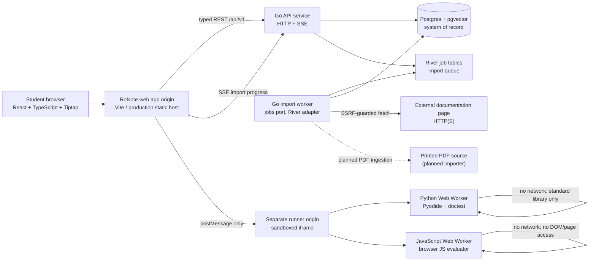

### Runtime units

| Unit | Technology | Responsibility | State |
|---|---|---|---|
| Web application | React, TypeScript, Vite, Tailwind v4 | Library, import dialog, document reader/editor, annotations, link following, run controls | Implemented |
| API | Go `cmd/api` | Authentication boundary, REST handlers, validation, document/annotation writes, import queuing, SSE | Implemented |
| Import worker | Go `cmd/worker`, River | Fetch, cache lookup, extraction, document creation, retries, status transitions | Implemented |
| Database | PostgreSQL + pgvector | Users, source cache, snapshots, extractions, documents, imports, annotations, River tables | Implemented |
| Runner | Separate origin, iframe, Web Workers | Execute trusted runtime code away from app origin | Implemented in dev/build; production hosting planned |
| PDF importer | Go importer producing the same IR | Read one printed PDF and emit source blocks | Planned |
| Authentication | GitHub OAuth (state, PKCE) and Postgres sessions; a fake provider in dev and test | Establish `owner_id` for every private query | Implemented (P15, ADR 0010) |

## 3. Request and import flow

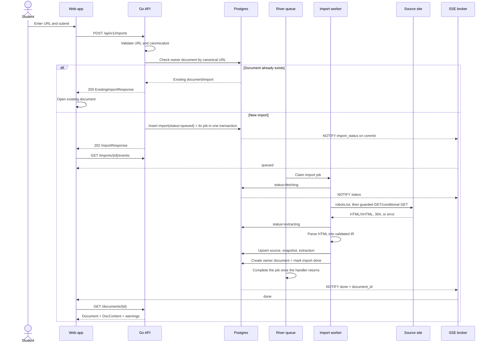

### Import status state machine

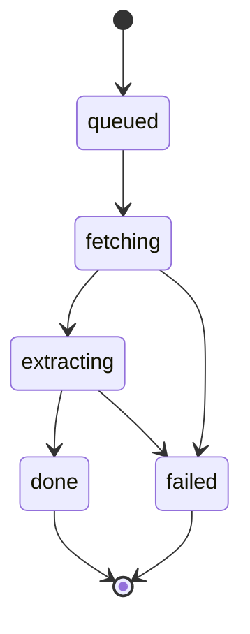

- `queued`, `fetching`, and `extracting` are non-terminal.
- `done` always has `document_id`.
- `failed` always has a stable `error_code`.
- Duplicate or retried jobs are idempotent and do not create a second document.
- The database trigger publishes every insert/status transition on `import_status`.
- The API keeps one Postgres LISTEN connection per process and fans notifications to SSE clients.
- SSE sends current status immediately, forwards only progress, heartbeats every 15 seconds, and closes on `done` or `failed`.

## 4. URL canonicalization and secure fetching

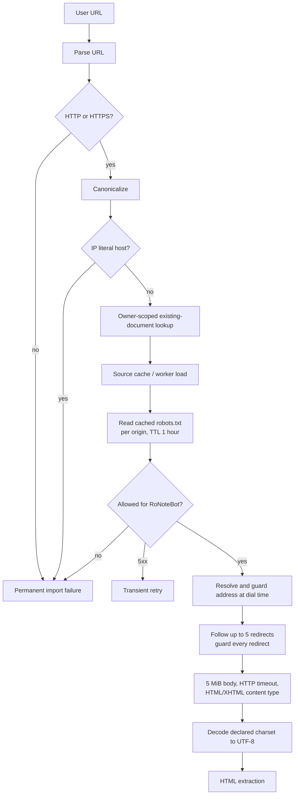

### Canonical URL rules

- Lowercase scheme and host.
- Remove default ports and fragments.
- Drop `utm_*`, `gclid`, and `fbclid`.
- Refuse IP-literal hosts at the API boundary.
- A page's `<link rel="canonical">` is trusted only when it is on the page's own host.
- Same-domain means same host, ignoring port and one leading `www.`; subdomains are external.

### Fetcher security and limits

- HTTP and HTTPS only; production ports are 80 and 443.
- DNS results are checked at dial time, including redirects.
- Always blocked: unspecified, multicast, reserved, IPv4-mapped IPv6, and `169.254.169.254`.
- Also blocked by default: loopback, private, link-local, CGNAT, ULA, and NAT64 ranges.
- Private-network access is available only in dev/test configuration.
- 5-second connect timeout and 20-second total request timeout.
- Maximum 5 MiB response body.
- Accept only `text/html` and `application/xhtml+xml`.
- One request per second per host per worker process.
- `ETag` and `Last-Modified` enable conditional GET.
- `robots.txt` is cached for one hour. A robots 5xx is transient and prevents fetching until retry.
- 4xx, invalid content, blocked address, robots disallow, size violations, and extraction errors are permanent.
- Timeouts, network errors, 5xx, 429, and robots 5xx are transient; retries are capped at three attempts. `Retry-After` is honored and capped at ten minutes.

## 5. Extraction and document model

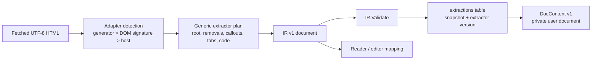

### IR v1

The IR is frozen at version 1. It is the common output of web and planned PDF importers:

- Block kinds: heading, paragraph, list, code, table, callout, image, quote, divider, tabs.
- Inline runs carry marks and typed links; raw HTML is not stored.
- Code may include language, title, and `title_link`.
- IDs are deterministic SHA-256 prefixes of heading path, block kind, and text; repeated IDs receive `-2`, `-3`, etc.
- `Validate` enforces shape, required fields, unique IDs, and absolute HTTP(S) links.
- Source metadata includes canonical URL, final URL, fetch time, body hash, validators, extractor name/version, and warnings.
- Code text is the page's copy payload when available; otherwise it is cleaned only of non-content chrome such as gutters, prompts marked unselectable, copy labels, and frame chrome. Visible code remains byte-identical.

### Framework adapters

Adapters are configuration under `internal/extract/adapter`, not separate transform implementations. Each adapter declares detection signals, content root, required structure, removable chrome, callout/tab rules, and code rules. Generic extraction owns the transformations.

Current registry order:

1. Starlight
2. Docusaurus
3. Material / MkDocs Material / Zensical
4. Sphinx
5. VitePress
6. mdBook
7. Docsy
8. go.dev
9. MDN
10. DocBook

An adapter falls back to generic extraction with `adapter_fallback` when its structure is missing, it would lose generic content, or removed chrome contains code. `low_confidence` indicates that no main content element was found.

## 6. Storage architecture

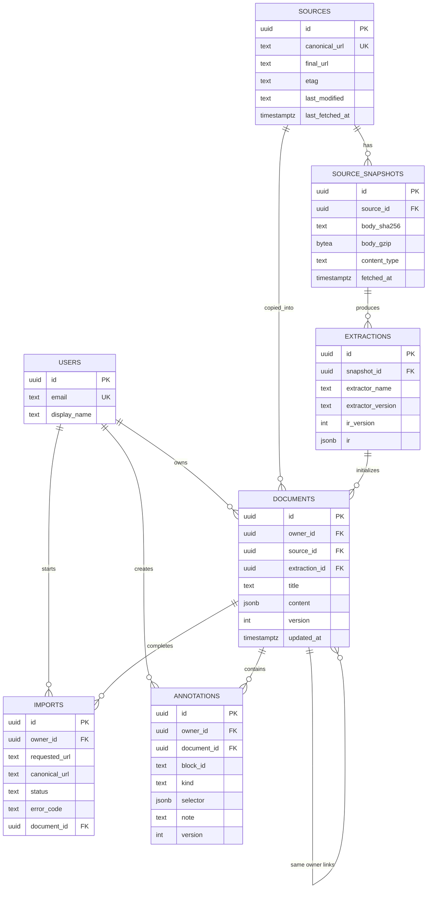

### Data ownership and consistency

- Shared tables: `sources`, `source_snapshots`, and `extractions`.
- Private tables: `documents`, `imports`, and `annotations`.
- Every private query includes `owner_id`.
- Composite foreign keys prevent cross-user document/import/annotation references.
- A unique `(owner_id, source_id)` constraint enforces one live document per user and source.
- A completed import and its document commit atomically; the job completes after, and a job delivered again finds the import done (ADR 0009).
- Source snapshots are gzip-compressed in Postgres and deduplicated by body SHA-256.
- A source is reused within `RONOTE_SOURCE_TTL` (default 24 hours). After expiry, the worker sends conditional requests.
- Extractions are reused by snapshot and extractor version; deterministic extraction still runs to detect the current adapter behavior.
- `version` on documents and annotations provides optimistic concurrency.
- Goose owns all schema, including River's tables. Migration 00006 normalizes River job times to the database clock.
- pgvector is available for future vector search, but v1 does not depend on a vector-search path.

## 7. Document editing and API boundary

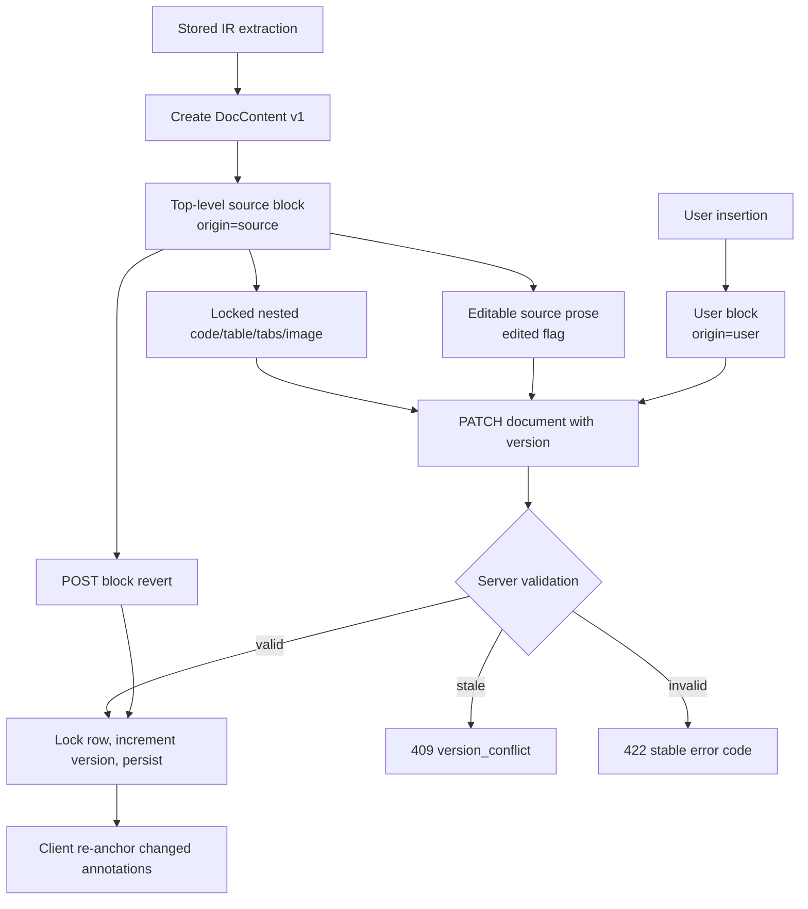

### DocContent v1

```text
{
  "doc_version": 1,
  "blocks": [
    {
      "...IR block fields": "...",
      "origin": "source | user",
      "edited": false,
      "source_block_id": "extraction-block-id"
    }
  ],
  "code_langs": {
    "code-block-id": "javascript"
  }
}
```

- Source blocks identify their extraction block and may be deleted but are not freely reordered in v1.
- User blocks may be paragraph, heading, list, quote, callout, or divider, including nested children.
- Code, tables, tabs, and images inside source blocks are locked byte-for-byte.
- An unedited source block must equal its extraction block.
- An edited source block is visibly marked and can be reverted.
- `code_langs` is optional user preference state; it changes highlighting only, never source code.
- Unedited source blocks are preserved exactly as loaded rather than re-serialized by Tiptap.

### REST API

Base path: `/api/v1`

| Endpoint | Purpose |
|---|---|
| `POST /imports` | Validate, canonicalize, deduplicate, and queue one URL import |
| `GET /imports/{id}` | Read owner-scoped import status |
| `GET /imports/{id}/events` | Follow progress as SSE |
| `GET /documents` | Cursor-paginated owner library, newest first |
| `GET /documents/{id}` | Read document content, source metadata, and warnings |
| `PATCH /documents/{id}` | Optimistically save DocContent |
| `POST /documents/{id}/blocks/{blockId}/revert` | Restore one source block |
| `POST /documents/resolve` | Resolve up to 200 same-domain links to owner documents |
| `GET /documents/{id}/annotations` | List highlights and notes |
| `POST /documents/{id}/annotations` | Create a highlight and optional note |
| `POST /documents/{id}/annotations/reanchor` | Atomically batch moved selectors |
| `PATCH /annotations/{id}` | Update note or re-place annotation |
| `DELETE /annotations/{id}` | Remove annotation |

All errors use one envelope with stable machine-readable codes and human-readable messages. Generated Go and TypeScript types come from `api/openapi.yaml`.

## 8. Web application architecture

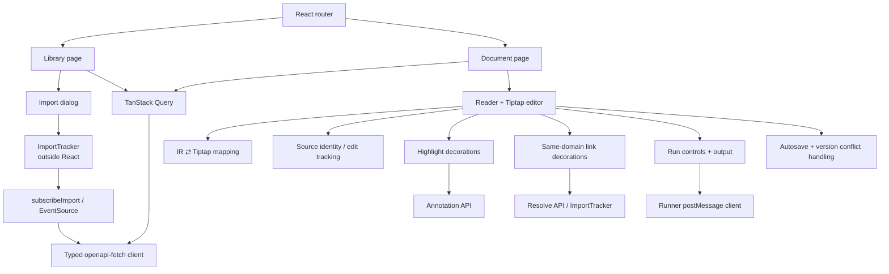

### Frontend state and boundaries

- `src/api/client.ts`: generated OpenAPI types and `openapi-fetch`.
- `src/api/queries.ts`: TanStack Query server state; all document queries share the `documents` key for invalidation.
- `src/api/events.ts`: the only EventSource wrapper.
- `src/imports/tracker`: import lifecycle is held outside React so closing a dialog never cancels an import.
- `src/document/mapping.ts`: IR to Tiptap and Tiptap to IR.
- `src/document/identity.ts`: source/user origin and edited-state tracking.
- `src/document/save.ts`: debounce, blur/hidden-page flush, retry/backoff, and conflict state.
- `src/document/anchoring.ts` and `highlights.ts`: pure anchoring and decoration rendering.
- `src/document/run`: classifier, runner client, Python/JavaScript UI, doctest presentation, output controls, and session status.
- Lazy chunks keep document editing, annotations, syntax highlighting, and running code within bundle budgets.
- API types are generated; hand-written copies of OpenAPI schema types are prohibited.

### Same-domain link flow

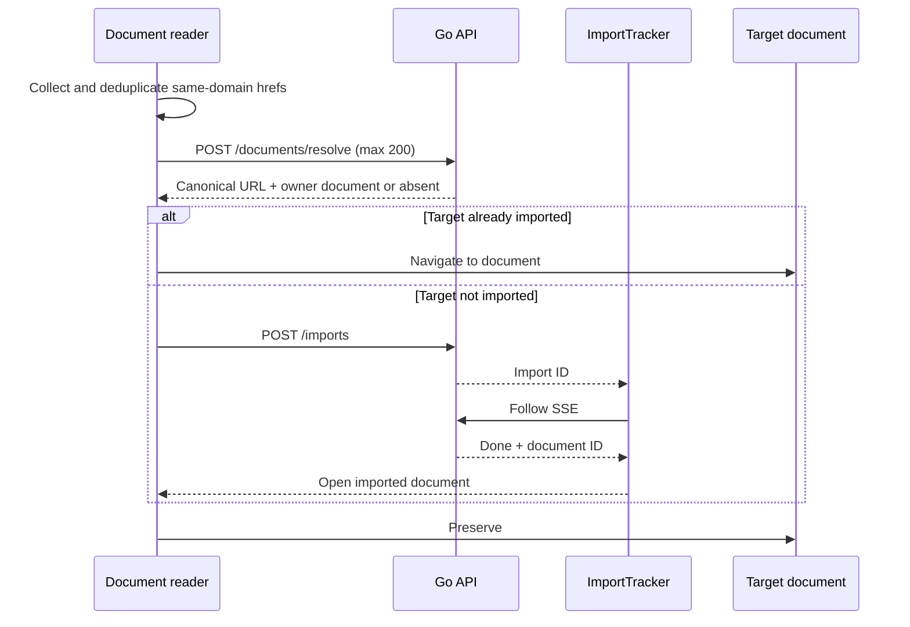

External links open in a new tab with `noopener noreferrer`. Cmd/Ctrl-click and middle-click open the original URL. Link status is rendered as decorations, never persisted as content edits.

## 9. Annotation architecture

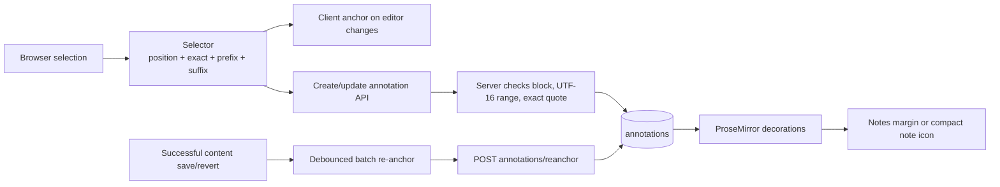

- One row represents one `highlight` annotation and optional note up to 5000 characters.
- Selectors target one block's plain text, with UTF-16 offsets matching browser behavior.
- Prefix and suffix are context hints up to 32 characters.
- Server verifies the exact quote on every write.
- Re-anchor order: original position, exact occurrences with context/distance scoring, fuzzy edit-distance match at similarity >= 0.75, then orphaned.
- Quotes under four characters never use fuzzy matching.
- Orphans are derived, not deleted: their quote and note remain available for removal or re-application.
- Highlights are decorations rather than marks, so they do not mutate source content.
- Annotation writes use per-row versions; stale updates return 409. Re-anchor batches are all-or-nothing.

## 10. Isolated code runner

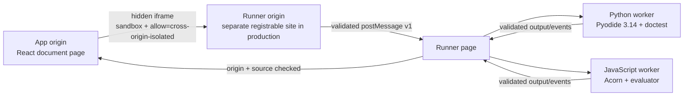

### Isolation model

- Document code never executes on the app origin.
- Production runner must use a separate registrable domain, not an app subdomain, to prevent SameSite/domain cookie exposure.
- The runner is embedded with `sandbox="allow-scripts allow-same-origin"`.
- App and runner use cross-origin isolation headers. The app uses COEP `credentialless` so imported images can load without credentials; the runner uses COEP `require-corp`.
- App and runner validate message version, exact shape, origin, and `event.source`.
- Runner CSP uses `connect-src 'self'`, preventing code from sending API/network requests. Only the JavaScript worker script gets `unsafe-eval`; Python and the runner page do not.
- The runner's own clock treats worker output as untrusted because executed JavaScript shares the worker realm.

### Runtime behavior

| Runtime | Execution | Shared state | Limits |
|---|---|---|---|
| Python | Pyodide in a Web Worker; standard library only | One `__main__` session per open document | 30 seconds, 1 MiB output, interrupt buffer where cross-origin isolation exists |
| Python doctest | Python `doctest` over block text as-is | Same Python session | Per-example pass/fail/known-difference results |
| JavaScript | Acorn-assisted evaluator in a dedicated Web Worker; top-level await | One worker global per open document | 30 seconds, 1 MiB output; Stop ends session because busy JS cannot be interrupted |

- Sessions start on first Run; Python can warm on first hover/focus of a Run or Check button.
- Runtime status is shown in the document header: not started, starting, idle, running.
- Restart creates a new runtime session; Stop and crash can discard session state.
- Unsupported classifications show one reason and may offer Run anyway only for selected fragment/missing-package cases.
- Classifier categories include browser Python, doctest, browser JavaScript, packages, network, secrets, input, DOM, shell, fragment, unlabelled, and unsupported.
- Executed code is never persisted as document content; output is ephemeral.

## 11. Security and privacy controls

### Server-side controls

- Every API route but sign-in requires a session: a host-only HttpOnly cookie holding a random token, of which Postgres keeps only the SHA-256 (ADR 0010).
- Unsafe requests from another site are refused (`http.CrossOriginProtection`, trusting only `RONOTE_PUBLIC_URL`).
- Per-user quotas (imports a day, documents) and per-user and per-IP rate limits; every route bounds its request body.
- Every document/import/annotation query is owner-scoped.
- Composite foreign keys enforce same-owner relationships.
- URL fetches use SSRF protection, redirect revalidation, robots.txt, body/type/time limits, and host rate limiting.
- User-provided content is validated against IR/DocContent rules before persistence.
- Source code is not rewritten or interpreted by the backend.
- API server has explicit read-header, read, write, idle, and header-size limits.

### Browser controls

- Imported content is rendered in the app but code execution is not.
- Source code runs only inside a separate-origin sandbox and workers.
- Runner CSP blocks network access and limits evaluation capability to the JavaScript worker.
- Runner messages are allowlisted by origin, source, version, shape, and size.
- App COOP/COEP isolate shared memory needed for Python interruption.
- External links use `noopener noreferrer`; images use `referrerpolicy="no-referrer"`.

## 12. Failure handling and observability

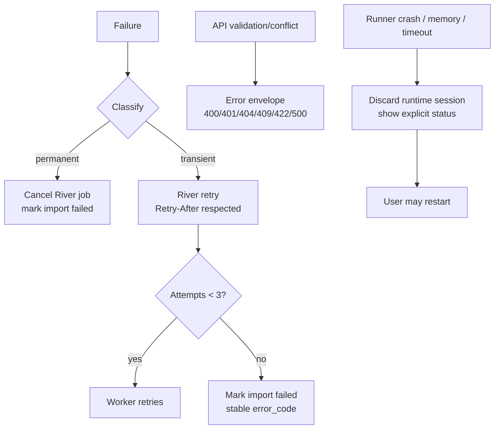

- Structured Go logging uses `slog`.
- API errors have stable codes and one user-facing sentence per code in the web app.
- Import status is observable through REST and SSE.
- Contract tests validate API responses against `api/openapi.yaml`.
- Unit tests, race tests, integration tests, live extractor tests, performance tests, web tests, E2E tests, and accessibility checks are exposed through Make targets.
- The CI commit job checks commit ranges, hook behavior, container-clock behavior, and process-group lifecycle behavior.

## 13. Deployment and environments

### Local development

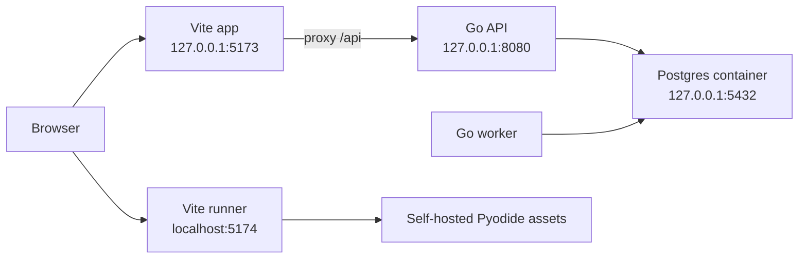

- `make dev-up` starts Postgres with pgvector.
- `make migrate-up` applies Goose migrations.
- `make run-api`, `make run-worker`, and `make web-dev` start managed process groups.
- `make stop` ends those groups and their children.
- The Vite app is pinned to `127.0.0.1:5173`; the runner uses `localhost:5174` so cookies remain cross-site.

### CI

- GitHub Actions uses pinned action SHAs and `ubuntu-26.04`.
- Main fast checks: Go/web lint, unit tests, performance tests, hooks tests.
- Additional jobs: generated-code check, integration tests with Postgres containers, live web/extractor checks, production web build, and Playwright E2E/accessibility checks.
- Generated outputs must be committed:
  - `internal/store/sqlcdb`
  - `internal/httpapi/gen`
  - `apps/web/src/api/schema.d.ts`

### Production direction

- Run API and worker as separate deployable Go processes.
- Run Postgres as the sole primary datastore, with persistent backups and migrations.
- Serve the app as static assets from the app origin.
- Serve the runner from a separate registrable origin with the same security headers as the Vite runner.
- Keep the runner host's JavaScript-worker path-specific CSP behavior.
- Add real authentication before staging/production use.
- Add durable/object storage for large PDF/source payloads when PDF import lands.

## 14. Invariants and design decisions

1. **Verbatim source:** source text and code are never silently rewritten.
2. **Frozen IR:** any incompatible IR shape change requires a new version and upgrade path.
3. **Private documents:** shared source cache never replaces a user's edited document.
4. **Owner isolation:** no private query or foreign key may cross owners.
5. **Idempotent imports:** duplicate jobs and retries produce at most one owner document.
6. **Optimistic concurrency:** document and annotation versions prevent lost updates.
7. **Annotations outside content:** highlights must not make source content unequal to extraction.
8. **Derived execution policy:** runnable/unsupported code classification is never stored as source truth.
9. **No code network:** document code cannot reach the API or arbitrary network destinations.
10. **One-page scope:** importing a link is an explicit user action, not crawling.
11. **Spec-first API:** OpenAPI is the contract; generated Go/TypeScript types are not hand-written.
12. **No AI-added text:** all generated machine metadata is clearly separate from reproduced source.

## 15. Current gaps and next phases

| Gap | Impact | Planned direction |
|---|---|---|
| Printed-PDF importer | Product currently imports web pages only | Add PDF parser that emits the existing IR v1 |
| Shared rate limits | API rate limits are process-local | Add a shared store before running a second API process |
| Production runner hosting | Runner is currently dev/build-ready | Deploy on a separate registrable domain with immutable assets and headers |
| Object storage | Source bodies and PDFs are stored in Postgres | Move large binary payloads to durable object storage when required |
| Multi-worker rate limiting | Host rate limit is process-local | Add shared coordination before scaling workers horizontally |
| Document re-import merge | Existing edited documents stay on their original extraction | Design explicit source update and user-edit merge workflow |
| Runner false completion | A compromised worker could claim completion early | Make runner completion and lifecycle handling robust against forged worker messages |
| Safari isolation | Safari cannot use COEP credentialless | Continue fallback where Stop ends and resets the runtime session |
| Code block wrapping in editor | Tiptap CSS can override reader horizontal scrolling | Correct editor `pre` white-space/overflow styling |

## 16. Diagram generation instructions for Eraser.io

Use the following as the visual diagram layout:

1. **Top row: clients and origins**
   - Student browser
   - App origin
   - Separate runner origin
   - Python and JavaScript workers inside runner
2. **Middle row: backend services**
   - Go API
   - Go import worker
   - River queue
   - SSE event broker
3. **Bottom row: persistence and external systems**
   - PostgreSQL + pgvector
   - Shared source cache
   - User document/annotation data
   - External documentation sites
   - Planned PDF input
4. Use **solid arrows** for implemented synchronous calls and **dashed arrows** for asynchronous jobs, notifications, and planned components.
5. Label security boundaries:
   - `owner_id` boundary around private data
   - SSRF/robots/size boundary around outbound fetching
   - separate-origin boundary around the runner
6. Label the primary flows:
   - `POST /imports -> River -> fetch -> extract -> persist -> SSE`
   - `GET/PATCH documents`
   - `annotations + re-anchor`
   - `resolve same-domain link -> existing document or import`
   - `postMessage -> isolated Python/JavaScript worker`

